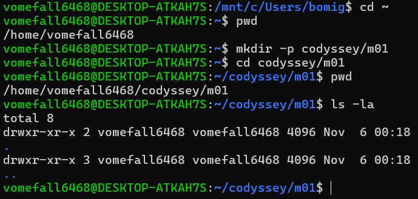
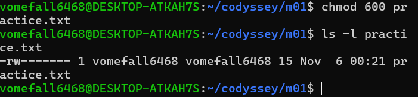
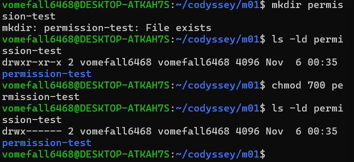
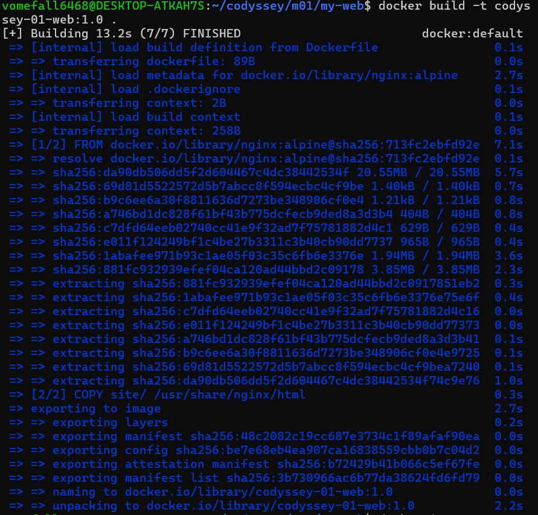
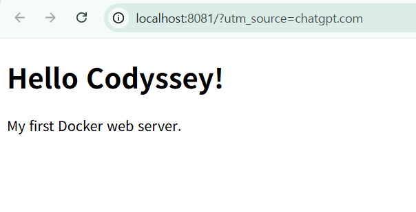
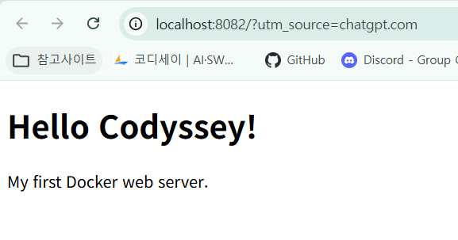
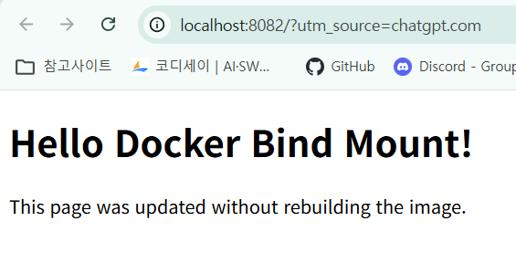
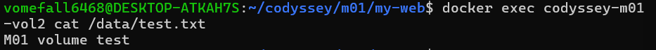
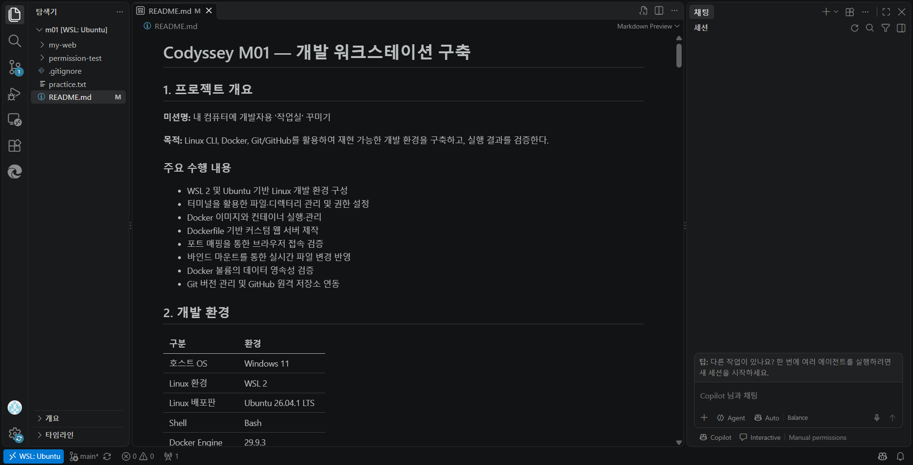
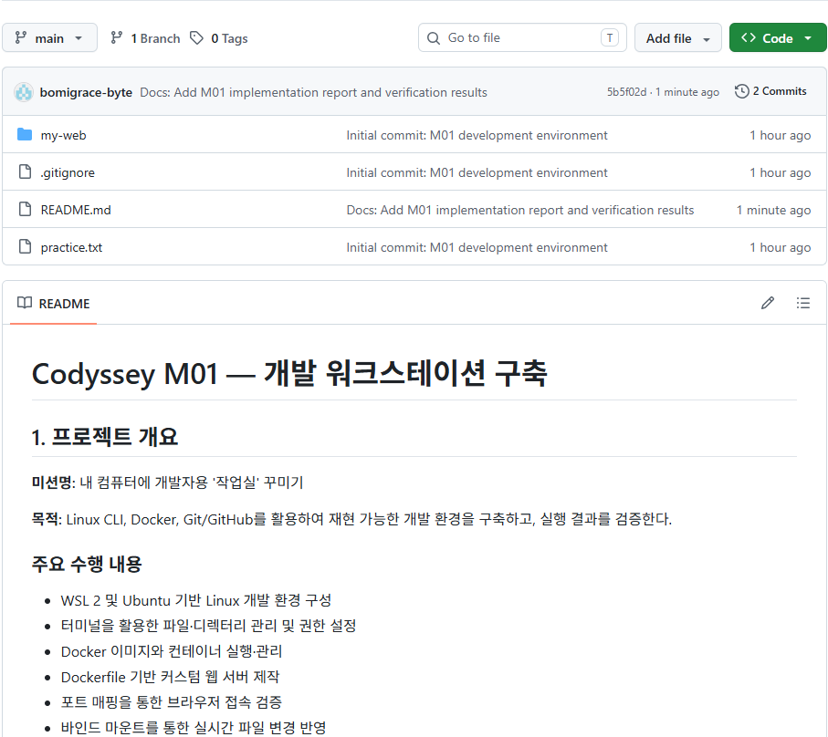

# Codyssey M01 — 개발 워크스테이션 구축

## 1. 프로젝트 개요

**미션명:** 내 컴퓨터에 개발자용 '작업실' 꾸미기

**목적:** Linux CLI, Docker, Git/GitHub를 활용하여 재현 가능한 개발 환경을 구축하고, 실행 결과를 검증한다.

### 주요 수행 내용

- WSL 2 및 Ubuntu 기반 Linux 개발 환경 구성
- 터미널을 활용한 파일·디렉터리 관리 및 권한 설정
- Docker 이미지와 컨테이너 실행·관리
- Dockerfile 기반 커스텀 웹 서버 제작
- 포트 매핑을 통한 브라우저 접속 검증
- 바인드 마운트를 통한 실시간 파일 변경 반영
- Docker 볼륨의 데이터 영속성 검증
- Git 버전 관리 및 GitHub 원격 저장소 연동

## 2. 개발 환경

| 구분 | 환경 |
|---|---|
| 호스트 OS | Windows 11 |
| Linux 환경 | WSL 2 |
| Linux 배포판 | Ubuntu 26.04.1 LTS |
| Shell | Bash |
| Docker Engine | 29.9.3 |
| Docker Compose | v5.7.0 |
| Git (Ubuntu) | 2.53.0 |
| 웹 서버 | NGINX (Alpine 기반) |
| 에디터 | nano |

## 3. 필수 수행 체크리스트

- [x] Linux CLI 기본 명령어 실습
- [x] 파일 및 디렉터리 권한 변경
- [x] Docker 설치 및 엔진 점검
- [x] Docker 이미지·컨테이너 관리
- [x] hello-world 및 Ubuntu 컨테이너 실행
- [x] Dockerfile 기반 커스텀 이미지 빌드
- [x] 포트 매핑 및 웹 서버 접속
- [x] 바인드 마운트 변경 반영
- [x] Docker 볼륨 영속성 검증
- [x] Git 설정 및 GitHub Push
- [ ] VS Code와 GitHub 연동 증거 확보
- [ ] 제출용 로그·스크린샷 정리
- [ ] 트러블슈팅 및 최종 제출 검증

## 4. Linux CLI 실습

### 4.1 파일 및 디렉터리 조작

| 명령어 | 수행 내용 |
|---|---|
| `pwd` | 현재 작업 경로 확인 |
| `ls -la` | 숨김 파일을 포함한 목록 조회 |
| `cd` | 디렉터리 이동 |
| `mkdir` | 디렉터리 생성 |
| `touch` | 빈 파일 생성 |
| `echo` | 문자열 출력 및 파일 기록 |
| `cat` | 파일 내용 확인 |
| `cp` | 파일 복사 |
| `mv` | 파일 이름 변경 |
| `rm` | 파일 삭제 |

주요 실습 명령어:

```bash
mkdir -p ~/codyssey/m01
cd ~/codyssey/m01

touch practice.txt
echo "hello Codyssey" > practice.txt
cat practice.txt

cp practice.txt copy.txt
mv copy.txt renamed.txt
rm renamed.txt
```

**검증 결과:** 파일 생성, 내용 기록, 복사, 이름 변경 및 삭제가 정상적으로 수행되었다.

### 4.2 파일 및 디렉터리 권한 변경

파일 권한 변경:

```bash
chmod 600 practice.txt
ls -l practice.txt
```

결과:

```text
-rw------- ... practice.txt
```

디렉터리 권한 변경:

```bash
chmod 700 permission-test
ls -ld permission-test
```

결과:

```text
drwx------ ... permission-test
```

| 대상 | 변경 전 | 변경 후 |
|---|---|---|
| practice.txt | 644 | 600 |
| permission-test | 755 | 700 |

**검증 결과:** 파일과 디렉터리의 접근 권한 변경에 성공했다.

### Linux CLI 및 권한 실습






## 5. Docker 설치 및 기본 운영

### 5.1 Docker 설치 확인

```bash
docker --version
docker info
```

확인 결과:

```text
Docker version 29.9.3
Server Version: 29.9.3
```

Docker CLI와 서버 연결이 정상 작동함을 확인했다.

### 5.2 hello-world 실행

```bash
docker run hello-world
```

출력 결과:

```text
Hello from Docker!
```

Docker 이미지를 사용하여 컨테이너를 생성하고 실행하는 데 성공했다.

### Docker 이미지 빌드


### 5.3 Ubuntu 컨테이너 실습

```bash
docker run -it ubuntu bash
```

컨테이너 내부에서 다음 명령어를 실행했다.

```bash
pwd
ls
echo "hello from Ubuntu container"
exit
```

종료한 컨테이너를 재시작하여 기존 컨테이너에 다시 접속하는 과정도 확인했다.

### 5.4 Docker 운영 명령어

| 명령어 | 검증 내용 |
|---|---|
| `docker images` | 로컬 이미지 목록 확인 |
| `docker ps` | 실행 중인 컨테이너 확인 |
| `docker ps -a` | 종료된 컨테이너 포함 목록 확인 |
| `docker start` | 기존 컨테이너 재시작 |
| `docker exec` | 실행 중인 컨테이너 내부 명령 실행 |
| `docker logs` | 컨테이너 로그 확인 |
| `docker stats --no-stream` | CPU·메모리 사용량 확인 |
| `docker stop` | 컨테이너 중지 |

리소스 측정 결과:

```text
CPU: 0.00%
MEM USAGE: 3.094MiB / 7.715GiB
MEM %: 0.04%
```

**검증 결과:** Docker 기본 운영 명령어의 정상 작동을 확인했다.

## 6. Dockerfile 기반 웹 서버 구축

### 6.1 프로젝트 구조

```text
my-web/
├── Dockerfile
└── site/
    └── index.html
```

### 6.2 베이스 이미지 선정

`nginx:alpine`을 베이스 이미지로 선택했다.

NGINX는 정적 웹 콘텐츠를 제공하는 웹 서버이며, Alpine 기반 이미지를 활용하여 별도의 복잡한 웹 애플리케이션 없이 실습 환경을 구성했다.

### 6.3 Dockerfile 작성

```dockerfile
FROM nginx:alpine
COPY site/ /usr/share/nginx/html/
```

**커스텀 내용:** 직접 작성한 `index.html`을 NGINX의 정적 콘텐츠 디렉터리에 복사했다.

### 6.4 커스텀 이미지 빌드

```bash
cd ~/codyssey/m01/my-web
docker build -t codyssey-01-web:1.0 .
docker images
```

검증 결과:

- 커스텀 이미지 빌드 성공
- 생성된 이미지: `codyssey-01-web:1.0`
- 이미지 ID: `3b730966ac6b`

## 7. 포트 매핑 검증

### 7.1 컨테이너 실행

```bash
docker run -d -p 8081:80 --name codyssey-m01-web codyssey-01-web:1.0
```

실행 상태 확인:

```bash
docker ps
```

포트 매핑:

```text
0.0.0.0:8081->80/tcp
```

### 7.2 브라우저 접속

접속 주소: `http://localhost:8081`

확인 결과:

```text
Hello Codyssey!
My first Docker web server.
```

**검증 결과: PASS**

Docker 컨테이너의 80 포트와 호스트의 8081 포트를 연결하여 웹페이지 접속에 성공했다.

### 실행 결과 스크린샷



## 8. 바인드 마운트 검증

### 8.1 바인드 마운트 적용

```bash
docker run -d -p 8082:80 \
  --name codyssey-m01-bind \
  --mount type=bind,source="$(pwd)/site",target=/usr/share/nginx/html,readonly \
  codyssey-01-web:1.0
```

### 8.2 변경사항 반영

호스트의 `site/index.html`을 수정했다.

수정 후 브라우저에서 확인한 결과:

```text
Hello Docker Bind Mount!
This page was updated without rebuilding the image.
```

접속 주소: `http://localhost:8082`

**검증 결과: PASS**

Docker 이미지를 다시 빌드하지 않고 호스트 파일의 변경사항이 웹페이지에 반영되는 것을 확인했다.

변경 전후 증거: 스크린샷 추가 예정

### 바인드 마운트 검증




## 9. Docker 볼륨 영속성 검증

### 9.1 볼륨 생성

```bash
docker volume create codyssey-m01-data
docker volume ls
```

### 9.2 데이터 저장

```bash
docker run -d --name codyssey-m01-vol1 \
  -v codyssey-m01-data:/data \
  ubuntu sleep infinity
```

```bash
docker exec codyssey-m01-vol1 \
  sh -c 'echo "M01 volume test" > /data/test.txt'
```

### 9.3 컨테이너 교체

```bash
docker rm -f codyssey-m01-vol1
```

동일한 볼륨을 연결하여 새로운 컨테이너를 생성했다.

```bash
docker run -d --name codyssey-m01-vol2 \
  -v codyssey-m01-data:/data \
  ubuntu sleep infinity
```

### 9.4 데이터 유지 확인

```bash
docker exec codyssey-m01-vol2 cat /data/test.txt
```

출력 결과:

```text
M01 volume test
```

**검증 결과: PASS**

기존 컨테이너를 제거하고 새로운 컨테이너에서 같은 볼륨을 연결한 뒤 저장된 데이터를 확인했다.

이를 통해 Docker 볼륨을 사용하면 컨테이너와 별도로 데이터를 유지할 수 있음을 확인했다.

### Docker 볼륨 영속성


## 10. Git 및 GitHub 연동

### 10.1 Git 초기 설정

```bash
git config --global user.name "작성자명"
git config --global user.email "GitHub 등록 이메일"
git config --global init.defaultBranch main
git config --global --list
```

### 10.2 Git 저장소 초기화

```bash
cd ~/codyssey/m01
git init
git status
```

### 10.3 첫 커밋 생성

```bash
git add .
git status
git commit -m "Initial commit: M01 development environment"
git log --oneline
git status
```

확인된 첫 번째 커밋:

```text
431c074 Initial commit: M01 development environment
```

### 10.4 GitHub 원격 저장소 연결

```bash
git remote add origin https://github.com/bomigrace-byte/Codyssey-AIO-M01.git
git branch -M main
git remote -v
```

### 10.5 GitHub Push

GitHub CLI를 통해 HTTPS 인증을 구성한 후 첫 번째 Push를 완료했다.

```bash
gh auth setup-git
git push -u origin main
```

결과:

```text
[new branch] main -> main
branch 'main' set up to track 'origin/main'.
```

**검증 결과: PASS**

GitHub 저장소:
https://github.com/bomigrace-byte/Codyssey-AIO-M01

### 10.6 VS Code 연동

진행 상태: 추가 확인 및 증거 확보 예정

### Git 및 VS Code




## 11. 트러블슈팅

### 사례 1. Docker 포트 매핑 실행 오류

**문제**

```text
docker: invalid reference format
```

**원인 가설**

컨테이너 실행 시 포트 매핑 옵션 `-p`를 누락하여 명령어 형식이 잘못되었을 가능성을 확인했다.

**확인**

실제로 입력한 명령어와 Docker의 오류 메시지를 비교했다.

**해결**

올바른 포트 매핑 옵션을 적용했다.

```bash
docker run -d -p 8081:80 --name codyssey-m01-web codyssey-01-web:1.0
```

**검증**

`docker ps`에서 컨테이너가 실행 중임을 확인했고, 브라우저에서 `localhost:8081` 접속에 성공했다.

### 사례 2. 바인드 마운트 웹 서버 접속 실패

**문제**

```text
ERR_CONNECTION_REFUSED
```

**원인 가설**

8082 포트에 연결되는 컨테이너가 실행되지 않았을 가능성을 검토했다.

**확인**

```bash
docker ps -a
docker logs codyssey-m01-bind
docker inspect codyssey-m01-bind
```

확인 결과 `codyssey-m01-bind` 컨테이너가 존재하지 않았다.

**해결**

바인드 마운트 설정을 포함한 `docker run` 명령어로 컨테이너를 다시 생성했다.

**검증**

`localhost:8082` 접속에 성공했으며, HTML 수정 후 변경사항이 정상 반영되었다.

### 사례 3. Docker 리소스 확인 명령어 오류

**문제**

`docker status --no-stream` 실행 시 옵션 오류 발생

**원인**

`status`와 `stats` 명령어 혼동

**해결**

```bash
docker stats --no-stream cc4aff576937
```

**검증**

CPU·메모리 등 컨테이너 리소스 사용량이 정상 출력되었다.

## 12. 최종 검증 결과 및 제출 현황

| 검증 항목 | 결과 |
|---|---|
| Linux CLI | PASS |
| 파일·디렉터리 권한 | PASS |
| Docker 설치 및 기본 운영 | PASS |
| Ubuntu 컨테이너 실행 | PASS |
| Dockerfile 이미지 빌드 | PASS |
| 웹 서버 포트 매핑 | PASS |
| 바인드 마운트 변경 반영 | PASS |
| Docker 볼륨 영속성 | PASS |
| GitHub 첫 Push | PASS |
| VS Code GitHub 연동 | 확인 예정 |
| 스크린샷 제출 증거 | 정리 예정 |
| 최종 재현성 검증 | 확인 예정 |

### 제출 전 확인사항

- [ ] 필수 수행 로그와 스크린샷 연결
- [ ] VS Code GitHub 연동 확인
- [ ] 개인정보·토큰·비밀번호 노출 점검
- [ ] README 링크 및 실행 절차 재검증
- [ ] 최종 Git commit 및 push

---

**학습 과정:** 2026 경남이노베이션아카데미 AI 올인원 제1기 입학연수과정

**미션:** M01 — 내 컴퓨터에 개발자용 '작업실' 꾸미기

